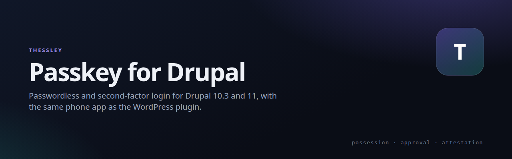

# Thessley Passkey for Drupal

   

[](https://netmate1234.github.io/thessley-passkey-drupal/)

Passwordless and second-factor login for Drupal with the Thessley Passkey app: a QR code — or a tap on the same phone — confirmed with the device's own biometric lock. Same wire protocol as the WordPress plugin, so the same app works for both.

## Quick install

```sh
git clone https://github.com/netmate1234/thessley-passkey-drupal.git /tmp/thessley-drupal
cp -r /tmp/thessley-drupal/thessley_passkey        /path/to/drupal/web/modules/contrib/
drush en thessley_passkey
drush cr
```

Then open **/admin/config/people/thessley-passkey** and pick a login method.

**Lockout prevention:** install and test the login module first in optional mode; keep a separate Drupal administrator recovery route and a tested database/files backup. Do not select app-required mode until multiple approvers and recovery have been proven. Install `thessley_windows_access` separately only for a scoped development pilot after reviewing its own prototype warnings; it is an infrastructure access integration, not a routine prerequisite. To recover a broken site login, use the hosting/Drush route to revert the module's login-mode configuration or disable the module; avoid uninstalling it unless data removal is intended.

**Verify:** `/user/login` shows the QR box; a phone enrolled on the site can approve and sign in.

Requirements: Drupal 10.6+ or 11, PHP 8.3+, `drush` optional.

## Modules

| Module | What it does |
| --- | --- |
| `thessley_passkey` | QR / one-tap sign-in for `/user/login`: optional, password-then-app, or app-only. Per-user device list, attestation and revocation. |
| `thessley_windows_access` | Distributed Windows account enrolment, PAM sign-in approvals and group-based resource access. Depends on `thessley_passkey`. |

## How it works

1. The site mints a one-time request: id, nonce, origin, short life.
2. The QR or tap link hands it to the app; the app shows the site and account.
3. The phone's lock authorises an ECDSA P-256 signature over the request.
4. The module verifies it against the enrolled public key and the site origin, then issues the session.

No shared secret is stored; the server keeps public keys only.

## Related

- [Thessley](https://github.com/netmate1234/Thessley) — project family and overview deck
- [Thessley Passkey protocol](https://github.com/netmate1234/thessley-passkey-server) — the wire format these modules implement
- [Thessley Passkey for WordPress](https://github.com/netmate1234/thessley-passkey-wordpress) — the same login for WordPress

## License

GPL-2.0-or-later.
